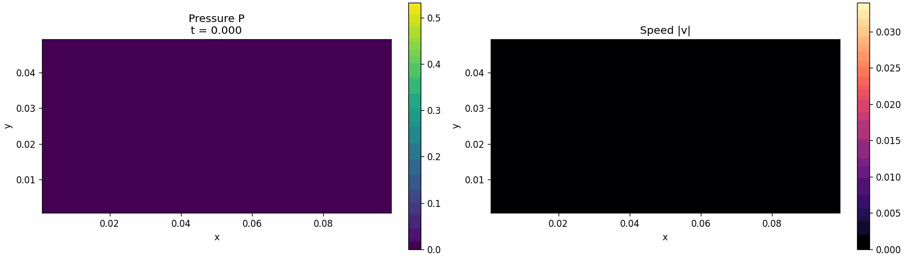

# Parallel 2D Navier–Stokes Solver (C++ / MPI / Parallel HDF5)

A distributed-memory solver for the 2D incompressible Navier–Stokes equations, written in C++ with MPI. A pressure difference drives flow through a channel (0.1 m × 0.05 m, water) past a rectangular obstacle, with optional periodic top/bottom boundaries. The grid is split into a 2D block decomposition across any number of MPI ranks. Ranks exchange halo rows with custom MPI derived datatypes, and all ranks write directly into one shared HDF5 file through parallel I/O.

<p align="center">
  
  <br><em>Velocity field evolving as flow develops around the obstacle (generated with <code>visualise.py</code> from the HDF5 output).</em>
</p>

## Method

- **Projection method** (Chorin splitting) on a collocated finite-difference grid:
  1. Compute an intermediate velocity with explicit viscous diffusion and first-order upwind advection.
  2. Solve the pressure Poisson equation by Jacobi iteration (relative tolerance 10⁻⁵).
  3. Project the velocity onto a divergence-free field.
- **Adaptive time step** from a Courant condition on the global maximum velocity.
- **Boundary conditions:**
  - pressure inlet (`P_max`) on the left; on the right, an outlet over the lower half and a wall over the upper half
  - no-slip or periodic top/bottom walls (`PERIODIC_BC`)
  - an optional internal rectangular obstacle (`ADD_OBSTACLE`, `OBS_*`)

## Parallel design

- **2D domain decomposition** for any process count. `find_tiles` picks the process grid `px × py` that minimises subdomain perimeter (and so halo traffic), which keeps tiles close to the aspect ratio of the full domain.
- **Halo exchange** uses non-blocking `MPI_Isend`/`MPI_Irecv`. Non-contiguous rows go through a custom `MPI_Type_create_struct` datatype straight from memory, with no pack/unpack buffers.
- **Global reductions** (`MPI_Allreduce`) supply the maximum velocity for time-step control and the Jacobi residual, so every rank converges in lockstep.
- **Parallel HDF5 output.** Each rank writes its interior tile into the global `P`, `u` and `v` datasets with hyperslab offsets. The full field is assembled in the file with no gather step on rank 0.
- **Contiguous storage.** Field arrays sit in contiguous 1D blocks behind a 2D indexing interface, for better cache locality.

## Strong scaling

Wall-clock time including HDF5 output, Open MPI 5 on an Apple M-series laptop (4 performance + 6 efficiency cores). Final diagnostics are identical across rank counts.

| Ranks | Default grid 202 × 102 (t = 50 s, 301k steps) | Speed-up | Large grid 802 × 402 (t = 0.5 s) | Speed-up |
|------:|------:|------:|------:|------:|
| 1 | 87.8 s | 1.00× | 102.6 s | 1.00× |
| 2 | 52.0 s | 1.69× | 33.3 s | 3.08× |
| 4 | 48.5 s | 1.81× | 26.1 s | 3.93× |
| 8 | 47.7 s | 1.84× | 24.2 s | 4.24× |

- **Default grid.** Only about 20k cells are spread across more than 300k time steps, so per-step halo exchanges and `MPI_Allreduce` latency dominate beyond 2 ranks.
- **Large grid.** The speed-up from 1 to 2 ranks is superlinear because each rank's working set shrinks into cache. Beyond 4 ranks, extra processes land on efficiency cores, which caps the gains.

## Build

Requires an MPI implementation and HDF5 built with parallel (MPI) support.

**macOS (Homebrew):**

```bash
brew install open-mpi hdf5-mpi
HDF5=$(brew --prefix hdf5-mpi)
mpicxx -O2 -o pns Parallel_Navier-Stokes.cpp -I"$HDF5/include" -L"$HDF5/lib" -lhdf5 -lm
```

**Linux (Debian/Ubuntu):**

```bash
sudo apt install libopenmpi-dev libhdf5-openmpi-dev
mpicxx -O2 -o pns Parallel_Navier-Stokes.cpp \
  -I/usr/include/hdf5/openmpi -L/usr/lib/x86_64-linux-gnu/hdf5/openmpi -lhdf5 -lm
```

## Run

```bash
mpiexec -n 4 ./pns
```

The solver writes `fields.h5`, which holds the grid geometry, the physical parameters, and `P`, `u`, `v` every `dt_out` seconds. Grid size and domain are set by `Nx`, `Ny`, `Lx` and `Ly` at the top of the source file.

## Post-processing

```bash
pip install h5py imageio numpy matplotlib
python3 visualise.py   # → fields_evolution.gif
```

## References

See [REFERENCES.md](REFERENCES.md). This was individual coursework for *Patterns for Parallel Programming* at Imperial College London (May 2026).
